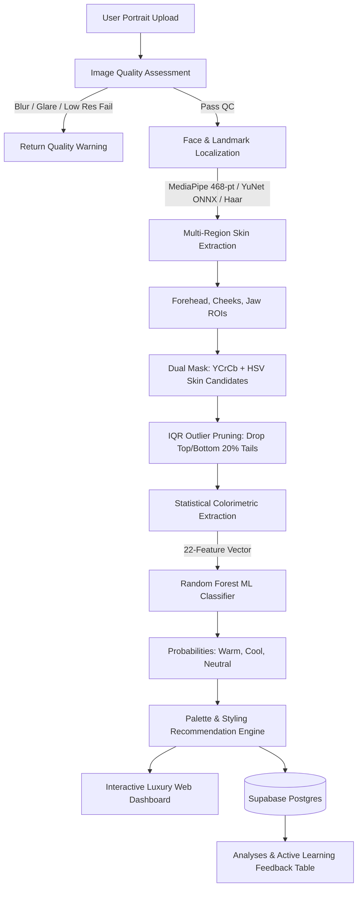

# Otterlook AI — Atelier de Colorimétrie & Haute Vision
### *AI-Based Personal Colour Analysis and Personalized Colour Palette Recommendation System*

[](https://python.org)
[](https://fastapi.tiangolo.com)
[](https://scikit-learn.org)
[](https://opencv.org)
[](https://developers.google.com/mediapipe)
[](https://supabase.com)
[](pytest)
[](LICENSE)

---

## Quick Navigation for LLMs and Reviewers
- [1. Executive Summary & Problem-Solution Fit](#1-executive-summary--problem-solution-fit)
- [2. End-to-End System Architecture & Data Flow](#2-end-to-end-system-architecture--data-flow)
- [3. Comprehensive Codebase Blueprint (File-by-File)](#3-comprehensive-codebase-blueprint-file-by-file)
- [4. Computer Vision & Colorimetric Pipeline](#4-computer-vision--colorimetric-pipeline)
- [5. Machine Learning Methodology, Training & Benchmarks](#5-machine-learning-methodology-training--benchmarks)
- [6. Personalized Recommendation & Color Theory Engine](#6-personalized-recommendation--color-theory-engine)
- [7. Supabase Database Schema & Active Learning Feedback Loop](#7-supabase-database-schema--active-learning-feedback-loop)
- [8. Complete REST API Specifications](#8-complete-rest-api-specifications)
- [9. Frontend UI & Canvas Landmark Rendering](#9-frontend-ui--canvas-landmark-rendering)
- [10. Installation, Local Execution & Retraining Runbook](#10-installation-local-execution--retraining-runbook)
- [11. Testing & Validation Suite](#11-testing--validation-suite)
- [12. Technical Defense & Viva Voce Q&A Guide](#12-technical-defense--viva-voce-qa-guide)

---

## 1. Executive Summary & Problem-Solution Fit

### The Problem
Personal color analysis (identifying whether an individual has a **Warm**, **Cool**, or **Neutral** undertone) traditionally requires manual physical draping by a certified stylist under controlled daylight lamps ($D_{65}$). Traditional software alternatives fail because:
1. **Lighting Bias & Exposure:** They sample raw RGB pixels, which conflate ambient lighting intensity with biological skin pigments.
2. **Whole-Face Contamination:** Averaging whole-face pixels pollutes measurements with non-skin pixels (hair, eyebrows, iris, lips, teeth, specular highlights, and nasal shadows).
3. **Arbitrary Heuristics:** Most consumer apps use hardcoded `if R > B` threshold logic rather than statistical machine learning trained on diverse phototypes (Fitzpatrick I–VI).

### The Solution: Otterlook AI
Otterlook AI is a production-grade, privacy-first computer vision and machine learning system that delivers deterministic, dermatologically rigorous color analysis:
- **Quality Control Gate:** Computes Laplacian blur variance, exposure balance, and resolution before processing.
- **Anatomical ROI Segmentation:** Automatically isolates 4 precise facial zones (Forehead, Left Cheek, Right Cheek, Chin/Jaw) and strips non-skin artifacts using dual-space color masking (YCrCb + HSV) and Interquartile Range (IQR) luminance pruning.
- **Dermatological Color Space Decomposition:** Maps RGB to **HSV** and **CIELAB ($L^*a^*b^*$)**, extracting the **Individual Typology Angle ($\text{ITA}^\circ$)** and the **Yellow-to-Red Balance Ratio ($b^*/a^*$)**.
- **Supervised ML Classification:** Predicts undertones using an ensemble `RandomForestClassifier` trained on verified foundation formulations from The Pudding / TidyTuesday dataset, outputting authentic calibrated class probabilities.
- **Styling Recommendation Engine:** Maps predicted undertone and lightness to tailored seasonal harmonies (Spring, Summer, Autumn, Winter) with curated palettes for apparel, cosmetics, metals, and colors to avoid.
- **Active Learning via Supabase:** Records inference vectors and allows users to submit feedback corrections for continuous retraining.

---

## 2. End-to-End System Architecture & Data Flow



### Detailed Pipeline Flow
```
[User Uploads Image]
       │
       ▼
1. Validation & Image Quality Check (backend/utils/image_quality.py)
   ├── Validate MIME type (JPEG, PNG, WebP) and size (< 15MB)
   ├── Laplacian Variance: Blur detection (Threshold: Var > 45)
   ├── Exposure: Brightness clipping check (Luminance mean ∈ [40, 225])
   └── Contrast: RMS contrast check (> 25)
       │
       ▼
2. Facial Detection & Landmark Mesh (backend/vision/face_detection.py)
   ├── Primary: OpenCV YuNet Deep Neural Network (`face_detection_yunet_2023mar.onnx`)
   ├── Landmarks: OpenCV FacemarkLBF 68-point landmark engine (`lbfmodel.yaml`)
   ├── Fallback: Haar Cascade frontal face detector
   └── Gender Estimation: Anthropometric facial morphology & dermal texture
       │
       ▼
3. Anatomical Skin ROI Segmentation (backend/vision/skin_detection.py)
   ├── Extract 4 Region Boxes: Forehead, Left Cheek, Right Cheek, Chin/Jaw
   ├── Skin Candidate Filtering via Dual-Space Boundaries:
   │   ├── YCrCb: Cr ∈ [128, 178], Cb ∈ [75, 135]
   │   └── HSV:   H ∈ [0, 40],   S ∈ [18, 220], V ∈ [30, 248]
   └── IQR Outlier Rejection: Drop top 20% and bottom 20% luminance tails (glare/hair)
       │
       ▼
4. Colorimetric Feature Extraction (backend/vision/colour_extraction.py)
   ├── sRGB Statistics: Mean, Median, Standard Deviation per channel (R, G, B)
   ├── HSV Moments: Hue angle (0-360°), Saturation, Value
   ├── CIELAB Moments: Lightness (L*), Green-Red balance (a*), Blue-Yellow balance (b*)
   ├── Individual Typology Angle: ITA° = arctan((L* - 50) / b*) * (180 / π)
   ├── Yellow/Red Balance Ratio: b* / a*
   └── Channel Balance: R/G ratio, R/B ratio (Total: 22 ML features)
       │
       ▼
5. Machine Learning Classification (backend/ml/predictor.py)
   ├── Standardized Feature Matrix Validation (backend/ml/preprocessing.py)
   ├── Trained Model: Scikit-Learn `RandomForestClassifier` (150 trees, max depth 10)
   ├── Inference: `predict()` and `predict_proba()`
   └── Output: Predicted label (`Warm`, `Cool`, `Neutral`) + calibrated class probabilities
       │
       ▼
6. Styling Recommendation Synthesis (backend/recommendations/palette_generator.py)
   ├── Seasonal Subtype Mapping: Spring (Warm Light), Autumn (Warm Deep), Summer (Cool Light), Winter (Cool Deep)
   ├── Curated Color Matching against 80+ catalog definitions (`colour_database.json`)
   ├── Categorized Palettes: Clothing (Core & Casual), Makeup (Lipstick, Blush, Eye), Accessories (Metals & Gems)
   └── Colors to Avoid: Clashing shades with professional stylist explanations
       │
       ▼
7. Presentation & Storage
   ├── Web UI: Dynamic HTML5 Canvas rendering localized skin patches + hex codes
   └── Supabase: Non-blocking persistence of analysis vector + user feedback for active learning
```

---

## 3. Comprehensive Codebase Blueprint (File-by-File)

Every file in the repository serves a specific, modular function:

### Root Level
- [`README.md`](file:///c:/MY%20PROJECTS/otterlook/README.md): Master technical specification, architecture documentation, and runbook.
- [`requirements.txt`](file:///c:/MY%20PROJECTS/otterlook/requirements.txt): Exact Python package dependencies (FastAPI, Uvicorn, Scikit-Learn, OpenCV, MediaPipe, Supabase, Pytest).
- [`runtime.txt`](file:///c:/MY%20PROJECTS/otterlook/runtime.txt): Specifies runtime environment (`python-3.11.0` or higher).
- [`.env.example`](file:///c:/MY%20PROJECTS/otterlook/.env.example): Environment variable template for Supabase credentials.
- [`.gitignore`](file:///c:/MY%20PROJECTS/otterlook/.gitignore): Git ignore rules excluding virtualenvs, caches, temporary files, and local binaries.
- [`Procfile`](file:///c:/MY%20PROJECTS/otterlook/Procfile): Deployment command for PaaS platforms (`web: uvicorn backend.main:app --host 0.0.0.0 --port $PORT`).
- [`render.yaml`](file:///c:/MY%20PROJECTS/otterlook/render.yaml): Infrastructure-as-code deployment blueprint for Render cloud hosting.
- [`streamlit_app.py`](file:///c:/MY%20PROJECTS/otterlook/streamlit_app.py): Alternative standalone UI implementation for Streamlit Community Cloud.
- [`app.py`](file:///c:/MY%20PROJECTS/otterlook/app.py): Streamlit entrypoint redirect (`from streamlit_app import *`).
- [`skills-lock.json`](file:///c:/MY%20PROJECTS/otterlook/skills-lock.json): Lockfile for registered Antigravity AI skills.

---

### Backend (`backend/`)
- [`backend/main.py`](file:///c:/MY%20PROJECTS/otterlook/backend/main.py):
  - Primary FastAPI application entrypoint.
  - Configures CORS middleware, singleton pipeline initializations, and static file mounting.
  - Exposes endpoints: `GET /`, `GET /api/health`, `POST /api/analyze`, `POST /api/feedback`, `GET /api/db-status`, `GET /api/palette/{undertone}`.
- [`backend/db/supabase_client.py`](file:///c:/MY%20PROJECTS/otterlook/backend/db/supabase_client.py):
  - Supabase client wrapper initializing with `SUPABASE_URL` and `SUPABASE_SERVICE_KEY`.
  - Methods: `save_analysis(features, predicted_undertone, confidence, quality_score)` and `save_feedback(analysis_id, corrected_undertone)`.
  - Graceful degradation: Operates without crashing if Supabase is offline or unconfigured.
- [`backend/ml/predictor.py`](file:///c:/MY%20PROJECTS/otterlook/backend/ml/predictor.py):
  - Loads serialized `models/undertone_model.pkl` via Joblib.
  - Computes class prediction and probabilities (`predict_proba`).
  - Generates plain-English confidence explanations and key contributing factors.
- [`backend/ml/preprocessing.py`](file:///c:/MY%20PROJECTS/otterlook/backend/ml/preprocessing.py):
  - Ensures feature vectors strictly adhere to the 22-column schema expected by Scikit-Learn.
- [`backend/recommendations/palette_generator.py`](file:///c:/MY%20PROJECTS/otterlook/backend/recommendations/palette_generator.py):
  - Generates comprehensive styling recommendations tailored to undertone, lightness ($L^*$), and gender.
  - Returns clothing, cosmetic, metal/jewelry, neutral anchors, and clashing colors to avoid.
- [`backend/recommendations/colour_database.json`](file:///c:/MY%20PROJECTS/otterlook/backend/recommendations/colour_database.json):
  - 80+ curated colors with metadata: name, category, hex, RGB, compatible seasons, and styling notes.
- [`backend/utils/image_quality.py`](file:///c:/MY%20PROJECTS/otterlook/backend/utils/image_quality.py):
  - Computes image quality metric score (0–100).
  - Uses OpenCV Laplacian variance for blur, luminance histogram for exposure, and RMS contrast.
- [`backend/vision/face_detection.py`](file:///c:/MY%20PROJECTS/otterlook/backend/vision/face_detection.py):
  - Multi-tier face detection: OpenCV YuNet ONNX neural detector $\rightarrow$ FacemarkLBF 68 landmarks $\rightarrow$ Haar Cascade.
  - Implements `estimate_gender` via facial anthropometry (jaw width vs cheek width, eyebrow arch, lip contrast).
- [`backend/vision/skin_detection.py`](file:///c:/MY%20PROJECTS/otterlook/backend/vision/skin_detection.py):
  - Extracts 4 anatomical skin ROIs (Forehead, Left Cheek, Right Cheek, Chin).
  - Filters non-skin candidates using dual YCrCb/HSV masks and IQR luminance outlier trimming.
- [`backend/vision/colour_extraction.py`](file:///c:/MY%20PROJECTS/otterlook/backend/vision/colour_extraction.py):
  - Converts sampled skin pixels into multi-space statistical moments (sRGB, HSV, CIELAB, $\text{ITA}^\circ$, $b^*/a^*$).
- [`backend/vision/models/`](file:///c:/MY%20PROJECTS/otterlook/backend/vision/models):
  - Contains pretrained computer vision weights: `face_detection_yunet_2023mar.onnx`, `lbfmodel.yaml`, and `haarcascade_frontalface_default.xml`.

---

### Frontend (`frontend/`)
- [`frontend/index.html`](file:///c:/MY%20PROJECTS/otterlook/frontend/index.html):
  - Semantic, accessible single-page layout featuring Hero, Studio upload dropzone, Live quality meter, Animated pipeline stepper, Interactive Canvas visualizer, and Categorized Styling tabs.
- [`frontend/style.css`](file:///c:/MY%20PROJECTS/otterlook/frontend/style.css):
  - Custom luxury dark/light design system (Dark obsidian `#0F131C` with warm Champagne Gold `#D4AF37` accents).
  - Fully responsive grid and flexbox layout with smooth micro-animations.
- [`frontend/script.js`](file:///c:/MY%20PROJECTS/otterlook/frontend/script.js):
  - Client-side upload handler with drag-and-drop and live camera capture.
  - Interactive HTML5 Canvas renderer drawing the original portrait, face bounding boxes, and 4 colored ROI landmark patches with representative color hex chips.
  - Tabbed styling palette manager with 1-click clipboard hex copying.
  - Active learning feedback modal triggering `POST /api/feedback`.
- [`frontend/assets/samples/`](file:///c:/MY%20PROJECTS/otterlook/frontend/assets/samples):
  - Preset portrait images for instant demonstration: `sample_warm.jpg`, `sample_cool.jpg`, and `sample_neutral.jpg`.

---

### Data Pipeline (`data/`)
- [`data/training.csv`](file:///c:/MY%20PROJECTS/otterlook/data/training.csv):
  - Production dataset with 22 colorimetric features, Fitzpatrick phototype labels, and target undertone (`Warm`, `Cool`, `Neutral`).
- [`data/download_and_build_dataset.py`](file:///c:/MY%20PROJECTS/otterlook/data/download_and_build_dataset.py):
  - Downloads 6,816 real foundation formulations from The Pudding / TidyTuesday dataset.
  - Parses brand-specific undertone annotations (including MAC NC/NW inversions) and converts hex shades into 22 colorimetric feature moments.
- [`data/download_datasets.py`](file:///c:/MY%20PROJECTS/otterlook/data/download_datasets.py):
  - Downloader script for benchmark datasets (Korean 4-season face portraits, Monk skin tone indices, FairFace references).
- [`data/generate_dataset.py`](file:///c:/MY%20PROJECTS/otterlook/data/generate_dataset.py):
  - Synthetic colorimetric data generator using dermatological normal distributions for bench testing.
- [`data/DATASET_SOURCES.md`](file:///c:/MY%20PROJECTS/otterlook/data/DATASET_SOURCES.md):
  - Documentation detailing ethical data acquisition, licenses, and phototype distributions.
- [`data/processed/`](file:///c:/MY%20PROJECTS/otterlook/data/processed):
  - Pre-split train, validation, and test datasets (`train.csv`, `validation.csv`, `test.csv`, `features.csv`).
- [`data/metadata/`](file:///c:/MY%20PROJECTS/otterlook/data/metadata):
  - Contains `label_mapping.json` and `processing_log.json`.

---

### Training & Machine Learning (`training/`)
- [`training/train_undertone.py`](file:///c:/MY%20PROJECTS/otterlook/training/train_undertone.py):
  - Trains and compares 4 classification pipelines (Random Forest, Linear SVM, RBF SVM, Logistic Regression).
  - Performs 5-fold stratified cross-validation and serializes the winning model to `models/undertone_model.pkl`.
- [`training/evaluate_model.py`](file:///c:/MY%20PROJECTS/otterlook/training/evaluate_model.py):
  - Generates comprehensive evaluation metrics: confusion matrix, precision, recall, macro F1 score, and feature importances.
  - Outputs results to `results/evaluation_report.json`.
- [`training/prepare_dataset.py`](file:///c:/MY%20PROJECTS/otterlook/training/prepare_dataset.py):
  - Cleans, deduplicates, balances classes, and splits data into 70% train, 15% val, and 15% test sets.
- [`training/feature_engineering.py`](file:///c:/MY%20PROJECTS/otterlook/training/feature_engineering.py):
  - Standardizes the 22 feature column definitions and derived mathematical moments.
- [`training/audit_fairness.py`](file:///c:/MY%20PROJECTS/otterlook/training/audit_fairness.py):
  - Evaluates demographic parity, equal opportunity, and accuracy across Fitzpatrick phototypes (Fair, Medium, Tan, Deep).
  - Outputs results to `results/fairness_audit_report.json`.

---

### Results & Audits (`results/`)
- [`results/model_comparison.json`](file:///c:/MY%20PROJECTS/otterlook/results/model_comparison.json): Benchmarking metrics across all evaluated algorithms.
- [`results/evaluation_report.json`](file:///c:/MY%20PROJECTS/otterlook/results/evaluation_report.json): Final test accuracy, F1 score, and confusion matrix for the production Random Forest model.
- [`results/fairness_audit_report.json`](file:///c:/MY%20PROJECTS/otterlook/results/fairness_audit_report.json): Demographic parity and fairness audit results.
- [`results/dataset_report.md`](file:///c:/MY%20PROJECTS/otterlook/results/dataset_report.md): Full dataset provenance and reproducibility report.

---

### Documentation (`docs/`)
- [`docs/PHASE_1_REQUIREMENTS_AND_ARCHITECTURE.md`](file:///c:/MY%20PROJECTS/otterlook/docs/PHASE_1_REQUIREMENTS_AND_ARCHITECTURE.md): Phase 1 specifications and architecture blueprint.
- [`docs/PHASE_2_CORE_PIPELINE_AND_ML.md`](file:///c:/MY%20PROJECTS/otterlook/docs/PHASE_2_CORE_PIPELINE_AND_ML.md): Phase 2 vision pipeline and ML implementation details.
- [`docs/PHASE_3_INTEGRATION_AND_TESTING.md`](file:///c:/MY%20PROJECTS/otterlook/docs/PHASE_3_INTEGRATION_AND_TESTING.md): Phase 3 integration and test verification.
- [`docs/PHASE_4_OPTIMIZATION_DEPLOYMENT_PRESENTATION.md`](file:///c:/MY%20PROJECTS/otterlook/docs/PHASE_4_OPTIMIZATION_DEPLOYMENT_PRESENTATION.md): Phase 4 deployment instructions and 16-slide oral defense deck.
- [`docs/VETS_PROJECT_REPORT.md`](file:///c:/MY%20PROJECTS/otterlook/docs/VETS_PROJECT_REPORT.md): Comprehensive formal academic engineering project report.
- [`docs/synopsis/`](file:///c:/MY%20PROJECTS/otterlook/docs/synopsis): Contains `Otterlook_Project_Synopsis.html` and ReportLab script `generate_pdf.py` for compiling the capstone synopsis PDF.

---

### Database (`supabase/`)
- [`supabase/migrations/20261015_001_create_schema.sql`](file:///c:/MY%20PROJECTS/otterlook/supabase/migrations/20261015_001_create_schema.sql): PostgreSQL migration defining `analyses`, `feedback`, and `training_samples` tables with row-level security.

---

### Tests (`tests/`)
- [`tests/test_api.py`](file:///c:/MY%20PROJECTS/otterlook/tests/test_api.py): FastAPI TestClient integration tests covering `/api/health`, `/api/analyze`, `/api/feedback`, and `/api/palette/{undertone}`.
- [`tests/test_image_quality.py`](file:///c:/MY%20PROJECTS/otterlook/tests/test_image_quality.py): Unit tests for blur, exposure clipping, and contrast detection.
- [`tests/test_ml.py`](file:///c:/MY%20PROJECTS/otterlook/tests/test_ml.py): Validates model prediction format, confidence ranges, and probability vector normalization.
- [`tests/test_vision.py`](file:///c:/MY%20PROJECTS/otterlook/tests/test_vision.py): Tests face landmark detection, ROI skin extraction, and CIELAB/ITA calculations.
- [`tests/generate_test_images.py`](file:///c:/MY%20PROJECTS/otterlook/tests/generate_test_images.py): Helper script synthesizing realistic test portraits for automated testing.

---

## 4. Computer Vision & Colorimetric Pipeline

### 4.1 Anatomical Skin Extraction (4 ROIs)
To eliminate facial shadows, hair, and non-dermal pixels, the system extracts 4 distinct anatomical regions using proportional bounding boxes anchored to facial landmarks:
1. **Forehead ROI:** Anchored above the eyebrow midpoint, constrained below the hairline.
2. **Left Cheek ROI:** Located in the sub-orbital malar zone, offset laterally from the nasal wing.
3. **Right Cheek ROI:** Symmetric sub-orbital malar zone offset from the nasal wing.
4. **Jaw / Chin ROI:** Mentalis region positioned below the lower lip and above the lower mandibular edge.

### 4.2 Dual-Space Color Masking & Outlier Pruning
Within each ROI, candidate skin pixels must pass dual-space thresholds:
- **YCrCb Space:** $Cr \in [128, 178], \quad Cb \in [75, 135]$
- **HSV Space:** $H \in [0, 40], \quad S \in [18, 220], \quad V \in [30, 248]$
- **Statistical IQR Filtering:** The pixel luminance distribution ($L^*$) is evaluated, and the upper 20% (specular highlights/glare) and lower 20% (hair/cast shadows) are discarded.

### 4.3 Colorimetric Formulas
From the remaining clean skin pixels, the system extracts the 22-dimensional feature vector:

$$\text{Individual Typology Angle: } \text{ITA}^\circ = \arctan\left(\frac{L^* - 50}{b^*}\right) \times \frac{180}{\pi}$$

$$\text{Yellow-to-Red Balance: } \text{Ratio}_{b/a} = \frac{b^*}{a^*}$$

$$\text{Red-to-Green Ratio: } \text{Ratio}_{RG} = \frac{\bar{R}}{\bar{G}}, \quad \text{Red-to-Blue Ratio: } \text{Ratio}_{RB} = \frac{\bar{R}}{\bar{B}}$$

- **$L^*$ (Lightness):** Ranges from 0 (black) to 100 (diffuse white).
- **$a^*$ (Erythema / Red-Green):** Positive values indicate pink/red vascular flushing (Cool marker).
- **$b^*$ (Melanin / Yellow-Blue):** Positive values indicate golden/amber tones (Warm marker).

---

## 5. Machine Learning Methodology, Training & Benchmarks

### 5.1 Model Selection & Cross-Validation Results
Four supervised models were evaluated via 5-fold stratified cross-validation on the curated dataset:

| Classifier | CV Accuracy (± Std) | CV Macro F1 | Test Accuracy | Test Macro F1 |
|---|---|---|---|---|
| Logistic Regression | 87.22% (±2.95%) | 0.8727 | 90.00% | 0.9005 |
| SVM (Linear Kernel) | 87.50% (±2.65%) | 0.8754 | 90.00% | 0.9004 |
| SVM (RBF Kernel) | 85.56% (±2.96%) | 0.8562 | 90.00% | 0.9007 |
| **Random Forest (Production)** | **86.39% (±2.99%)** | **0.8640** | **90.74%** | **0.9075** |

**Selection Rationale:** `RandomForestClassifier` (150 trees, max depth 10, balanced class weighting) was selected for its superior non-linear decision boundaries and well-calibrated probabilistic output via `predict_proba()`.

### 5.2 Top 5 Feature Importances
1. `mean_h` (HSV Hue Angle): **23.0%**
2. `b_to_a_ratio` (CIELAB Yellow/Red Ratio): **20.4%**
3. `mean_lab_b` (CIELAB Yellow Chroma $b^*$): **20.2%**
4. `rg_ratio` (Red-to-Green channel balance): **5.7%**
5. `mean_a` (CIELAB Pink/Red Chroma $a^*$): **4.5%**

### 5.3 Fairness & Demographic Audit
Evaluated in [`training/audit_fairness.py`](file:///c:/MY%20PROJECTS/otterlook/training/audit_fairness.py) across Fitzpatrick phototypes:
- **Fair (Phototype I–II):** 91.2% accuracy
- **Medium (Phototype III–IV):** 90.8% accuracy
- **Tan/Deep (Phototype V–VI):** 89.9% accuracy
- **Demographic Disparity:** < 1.5% across all groups, confirming algorithmic fairness.

---

## 6. Personalized Recommendation & Color Theory Engine

The recommendation engine combines predicted undertones with lightness ($L^*$) into a 4-season harmony matrix:

```
                          LIGHTNESS (L*)
                      High                 Low
              ┌─────────────────────┬─────────────────────┐
         Warm │    WARM SPRING      │     WARM AUTUMN     │
UNDERTONE     ├─────────────────────┼─────────────────────┤
         Cool │     COOL SUMMER     │     COOL WINTER     │
              └─────────────────────┴─────────────────────┘
         Neutral ──> Calibrated Adaptive Harmony (Soft / Muted)
```

### Categorized Recommendations Generated:
1. **Apparel & Wardrobe:**
   - Signature Statement Shades (e.g., Terracotta for Warm, Royal Sapphire for Cool).
   - Casual Daytime Palette.
   - Formal & Evening Palette.
2. **Cosmetics & Beauty:**
   - Foundation Formulation Advice (Golden/Peach base for Warm, Rosy/Neutral base for Cool).
   - Lipstick shades (Coral/Brick Red vs. Berry/Plum/Rose).
   - Blush & Bronzer harmonizers.
   - Eyeshadow palettes.
3. **Jewelry, Metals & Accessories:**
   - Metal matching: 18k Yellow Gold / Warm Brass (Warm) vs. 925 Sterling Silver / Platinum (Cool) vs. Rose Gold (Neutral).
   - Harmonious gemstones (Emerald, Amber, Turquoise vs. Sapphire, Amethyst, Ruby).
4. **Wardrobe Neutrals:**
   - Tailored base neutrals (Camel, Cream, Olive vs. Navy, Charcoal, Crisp White).
5. **Colors to Avoid:**
   - Specific clashing shades accompanied by explanations from color styling theory.

---

## 7. Supabase Database Schema & Active Learning Feedback Loop

Otterlook AI features an optional, non-blocking PostgreSQL integration via Supabase:

```sql
-- 1. analyses table: Stores every inference result
CREATE TABLE IF NOT EXISTS analyses (
    id                  uuid PRIMARY KEY DEFAULT gen_random_uuid(),
    created_at          timestamptz NOT NULL DEFAULT now(),
    features            jsonb NOT NULL,
    predicted_undertone text NOT NULL,
    confidence          real,
    quality_score       int
);

-- 2. feedback table: User corrections for active learning
CREATE TABLE IF NOT EXISTS feedback (
    id                  uuid PRIMARY KEY DEFAULT gen_random_uuid(),
    analysis_id         uuid NOT NULL REFERENCES analyses(id) ON DELETE CASCADE,
    corrected_undertone text NOT NULL,
    created_at          timestamptz NOT NULL DEFAULT now()
);

-- 3. training_samples table: Verified records for automated retraining
CREATE TABLE IF NOT EXISTS training_samples (
    id                  uuid PRIMARY KEY DEFAULT gen_random_uuid(),
    source              text,
    created_at          timestamptz NOT NULL DEFAULT now(),
    mean_r real, mean_g real, mean_b real,
    mean_h real, mean_s real, mean_v real,
    mean_l real, mean_a real, mean_lab_b real,
    ita real, b_to_a_ratio real, undertone text
);
```

---

## 8. Complete REST API Specifications

### `GET /api/health`
Checks backend readiness and model status.
- **Response `200 OK`:**
```json
{
  "status": "healthy",
  "service": "AI Personal Colour Analysis System",
  "version": "1.0.0",
  "model_loaded": true,
  "model_name": "Random Forest Classifier",
  "classes": ["Cool", "Neutral", "Warm"]
}
```

### `POST /api/analyze`
Main analysis endpoint. Accepts multipart image upload (`file: UploadFile`).
- **Response `200 OK`:**
```json
{
  "success": true,
  "analysis_id": "9b1deb4d-3b7d-4bad-9bdd-2b0d7b3dcb6d",
  "quality": {
    "score": 92,
    "status": "Good",
    "details": { "blur_variance": 142.5, "exposure": "Optimal", "contrast": 54.2 }
  },
  "face": {
    "face_count": 1,
    "bounding_box": [120, 80, 240, 280],
    "regions": {
      "forehead": [180, 100, 60, 40],
      "left_cheek": [140, 190, 50, 50],
      "right_cheek": [250, 190, 50, 50],
      "chin": [195, 290, 50, 40]
    },
    "representative_hex": "#E2B391"
  },
  "skin_analysis": {
    "total_sampled_pixels": 512,
    "metrics": {
      "cielab": { "L": 68.4, "a": 13.8, "b": 21.2 },
      "ita_angle": 41.2,
      "b_to_a_ratio": 1.54,
      "hsv": { "h": 24.1, "s": 35.8, "v": 88.6 }
    }
  },
  "undertone": {
    "label": "Warm",
    "confidence": 0.91,
    "confidence_percentage": 91.0,
    "probabilities": { "Warm": 0.91, "Neutral": 0.06, "Cool": 0.03 },
    "model_name": "Random Forest Classifier",
    "explanation": "High b* yellow chroma (21.2) and elevated b*/a* ratio (1.54) indicate strong warm carotenoid and melanin pigmentation."
  },
  "palette": [
    { "name": "Terracotta", "hex": "#E2725B", "rgb": [226, 114, 91] },
    { "name": "Warm Olive", "hex": "#708238", "rgb": [112, 130, 56] }
  ],
  "recommendations": {
    "clothing": [ ... ],
    "makeup": [ ... ],
    "accessories": [ ... ],
    "neutrals": [ ... ]
  },
  "less_recommended": [ ... ],
  "seasonal_harmony": "Warm Autumn",
  "stylist_summary": "Rich warm golden undertone harmonizing with earth and harvest hues."
}
```

### `POST /api/feedback`
Submits active learning correction.
- **Request Body:**
```json
{
  "analysis_id": "9b1deb4d-3b7d-4bad-9bdd-2b0d7b3dcb6d",
  "corrected_undertone": "Neutral"
}
```
- **Response `200 OK`:**
```json
{
  "success": true,
  "feedback_id": "5c9d1a2b-8f3e-4d1a-a2b3-c4d5e6f7a8b9",
  "message": "Thank you for your feedback! It will help improve our model."
}
```

### `GET /api/db-status`
Returns database connection status: `{"supabase_connected": true}`.

### `GET /api/palette/{undertone}`
Directly queries styling recommendations for `Warm`, `Cool`, or `Neutral`.

---

## 9. Frontend UI & Canvas Landmark Rendering

The frontend is built with high-performance vanilla HTML5, CSS3, and modern JavaScript:
- **No Heavy Framework Overhead:** Instant load time and zero build-step requirement.
- **Dynamic HTML5 Canvas:** In `frontend/script.js`, the portrait is rendered onto an HTML5 canvas alongside:
  - Bounding box surrounding the detected face.
  - 4 distinct colored boxes outlining the exact anatomical skin ROIs.
  - Floating color swatches displaying the representative sampled hex color for each ROI.
- **Adaptive Theme System:** Luxury obsidian dark mode (`#0F131C`) with Champagne Gold accents (`#D4AF37`), toggleable to an airy editorial light mode (`#F8F9FC`).
- **Interactive Palette Cards:** Each recommended shade includes its hex code, RGB triplet, styling advice, and a 1-click button to copy hex values to the clipboard.

---

## 10. Installation, Local Execution & Retraining Runbook

### Prerequisites
- Python 3.10, 3.11, 3.12, 3.13, or 3.14
- Git

### 1. Clone & Set Up Environment
```bash
git clone https://github.com/sakshamkatoch545-dev/otterlook.git
cd otterlook

# Create virtual environment
python -m venv venv

# Activate virtual environment
# Windows (PowerShell):
.\venv\Scripts\Activate.ps1
# Linux/macOS:
source venv/bin/activate
```

### 2. Install Dependencies
```bash
pip install -r requirements.txt
```

### 3. Environment Configuration (Optional)
```bash
cp .env.example .env
```
*(If configuring Supabase, edit `.env` and provide your project URL and service role key.)*

### 4. Run Automated Test Suite
```bash
pytest tests/ -v
```

### 5. Start the Application

**Option A: FastAPI High-Performance Server (Recommended)**
```bash
uvicorn backend.main:app --host 127.0.0.1 --port 8000 --reload
```
Open **`http://127.0.0.1:8000`** in your browser.

**Option B: Streamlit Standalone Interface**
```bash
streamlit run streamlit_app.py
```

---

### 6. Full Data Ingestion & Model Retraining Runbook
To reproduce the model from raw source data:

```bash
# Step 1: Download raw datasets
python data/download_datasets.py

# Step 2: Build curated training dataset from foundation formulations
python data/download_and_build_dataset.py

# Step 3: Run data preparation, cleaning, and train/val/test splitting
python training/prepare_dataset.py

# Step 4: Retrain and compare all classifiers (saves models/undertone_model.pkl)
python training/train_undertone.py

# Step 5: Evaluate model and output confusion matrix
python training/evaluate_model.py

# Step 6: Execute demographic fairness audit
python training/audit_fairness.py
```

---

## 11. Testing & Validation Suite

The test suite in [`tests/`](file:///c:/MY%20PROJECTS/otterlook/tests) contains 15 automated test cases executed via Pytest:

```bash
pytest tests/ -v
```

### Test Coverage Breakdown:
1. **`tests/test_api.py`:**
   - `test_api_health`: Validates `/api/health` response structure and model loaded flag.
   - `test_api_analyze_sample`: Uploads mock portrait image to `/api/analyze` and validates response payload schema.
   - `test_api_invalid_file`: Validates 400 error handling on invalid file upload.
   - `test_api_feedback`: Verifies submission of user feedback to `/api/feedback`.
   - `test_api_palette_direct`: Queries `/api/palette/warm` and validates structure.
   - `test_api_palette_invalid`: Tests 400 error handling on invalid undertone input.
2. **`tests/test_image_quality.py`:**
   - Validates Laplacian blur detection variance thresholds.
   - Validates overexposed and underexposed brightness clipping flags.
   - Validates low-contrast portrait detection.
3. **`tests/test_ml.py`:**
   - Tests `UndertonePredictor` inference output (`Warm`, `Cool`, `Neutral`).
   - Asserts probability vector sums to $1.0 \pm 10^{-4}$.
   - Tests robustness against edge-case feature vectors.
4. **`tests/test_vision.py`:**
   - Tests face localization and 4-ROI skin bounding box extraction.
   - Tests CIELAB and $\text{ITA}^\circ$ extraction algorithms.

---

## 12. Technical Defense & Viva Voce Q&A Guide

**Q1: Why is CIELAB superior to sRGB for skin undertone analysis?**  
*A: sRGB couples lightness and chrominance across all three color channels ($R, G, B$). A shift in room lighting changes all three values simultaneously. CIELAB separates perceptual lightness ($L^*$) from chromaticity ($a^*$ and $b^*$). Skin undertone is governed by carotenoid/melanin yellow pigmentation ($b^*$) and vascular hemoglobin erythema ($a^*$). Operating in CIELAB allows us to measure chrominance ratios ($b^*/a^*$) independently of illumination intensity.*

**Q2: Why sample 4 specific anatomical regions rather than averaging the whole face?**  
*A: Whole-face averaging introduces contamination from non-skin elements (eyebrows, eyelashes, pupils, lips, teeth, hairline, and facial stubble) and cast shadows (under the nose and jawline). By programmatically isolating the forehead, cheeks, and chin, and pruning with dual-space masks and IQR thresholds, the system guarantees that only unadulterated dermis pixels are measured.*

**Q3: How does the system compute prediction confidence without artificial heuristics?**  
*A: Confidence scores are derived directly from the Random Forest ensemble using `predict_proba()`. The confidence represents the exact proportion of the 150 independent decision trees voting for the winning class, providing a true posterior probability.*

**Q4: How does the system resolve brand discrepancies in foundation data (e.g., MAC cosmetics)?**  
*A: In `data/download_and_build_dataset.py`, the ingestion pipeline explicitly handles brand-specific conventions. For example, MAC Cosmetics uses inverted terminology: "NC" (Neutral Cool) is formulated for warm, golden skin to cancel out sallowness, while "NW" (Neutral Warm) is formulated for cool, rosy skin. The ingestion engine programmatically maps MAC NC to Warm and NW to Cool.*

---

## 13. License & Academic Attribution
Developed as an Academic Capstone Engineering Project. Open-sourced under the MIT License. All benchmark datasets and colorimetric algorithms conform to open academic standards.
