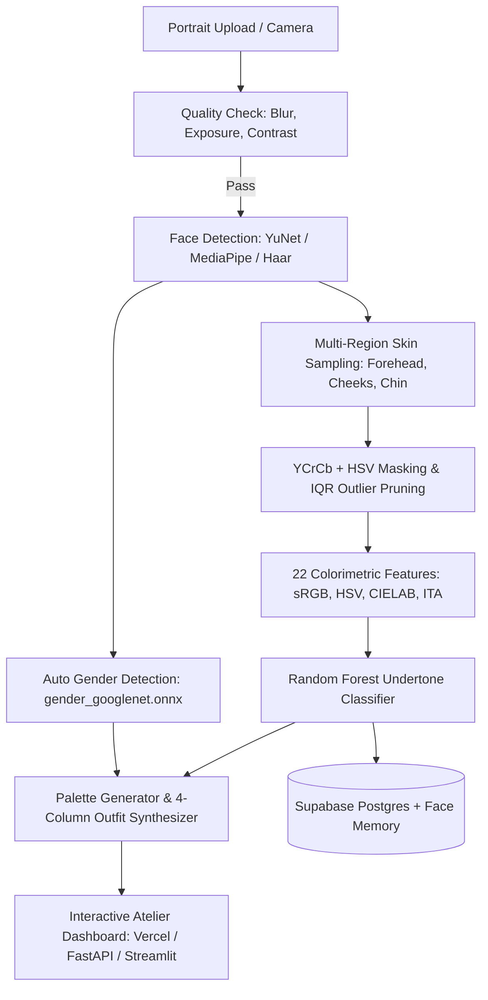

# Otterlook AI — Atelier de Colorimétrie & Haute Vision

### *AI-Based Personal Colour Analysis, Automatic Gender-Aware Styling & Curated Lookboard System*

[](https://python.org)
[](https://fastapi.tiangolo.com)
[](https://streamlit.io)
[](https://otterlook.vercel.app/)
[](https://opencv.org)
[](https://scikit-learn.org)
[](https://supabase.com)

---

## Overview

**Otterlook AI** is a full-stack computer vision and machine learning personal colorimetry platform that analyzes a portrait under dermatological color spaces (**CIELAB $L^*a^*b^*$**, **$\text{ITA}^\circ$**, **HSV**, **sRGB**) to classify skin undertone (**Warm**, **Cool**, or **Neutral**) and synthesize personalized seasonal palettes, cosmetic/horology pairings, and 4-column illustrated outfit lookboards.

### Key Highlights
- **Multi-Engine Face & Landmark Localization:** Uses a tiered cascade (**YuNet ONNX**, **MediaPipe**, **YOLOv8-Face**, and **Haar Cascade**) with 68-point anatomical ROI placement (forehead, left cheek, right cheek, chin).
- **Auto-Detect Gender ("All Styles"):** When **All Styles** is selected, OpenCV DNN (`gender_googlenet.onnx`) automatically detects `male` or `female` from the cropped face and calibrates palettes, jewellery/beauty panels, and garment silhouettes accordingly.
- **4-Column Atelier Lookboards:** Generates bespoke SVG lookboards (`01 • UPPERWEAR`, `02 • BOTTOMWEAR`, `03 • FOOTWEAR`, `04 • JEWELLERY & BEAUTY / HOROLOGY`) with dedicated **Womenswear** (`BLOUSE`, `SKIRT`, `HEELS`) and **Menswear** (`SHIRT`, `TROUSER`, `SHOES`) illustrations, chromatic formulas, and progressive 1-by-1 reveal.
- **Biometric Face Memory:** Extracts facial embeddings to recognize returning clients and preserve calibrated signature palettes (with automatic `/tmp` fallback on read-only serverless filesystems).
- **Unified Web & Streamlit Experience:** Identical luxury atelier UI served directly by FastAPI, Vercel Serverless (`https://otterlook.vercel.app/`), and Streamlit (`streamlit_app.py`).
- **Active Learning via Supabase:** Persists analysis vectors and user feedback (`POST /api/feedback`) when Supabase credentials are configured, with graceful offline fallback.

---

## System Architecture



---

## Project Structure

```text
otterlook/
├── api/
│   ├── index.py                  # Vercel ASGI entrypoint exporting FastAPI app
│   └── requirements.txt          # Lightweight serverless Python dependencies
├── backend/
│   ├── main.py                   # FastAPI app, /api/analyze, /api/generate-outfits, /api/feedback
│   ├── db/
│   │   ├── supabase_client.py    # Supabase Postgres integration (analysis & feedback)
│   │   └── face_memory.py        # SQLite biometric face memory with /tmp serverless fallback
│   ├── ml/
│   │   ├── predictor.py          # Undertone Random Forest inference wrapper
│   │   └── preprocessing.py      # 22-feature schema alignment
│   ├── recommendations/
│   │   ├── colour_database.json  # Curated color catalog with seasonal metadata
│   │   ├── palette_generator.py  # Seasonal & undertone palette engine
│   │   └── outfit_synthesizer.py # 4-column SVG lookboard generator (Menswear & Womenswear)
│   ├── utils/
│   │   └── image_quality.py      # Laplacian blur, brightness & RMS contrast checks
│   └── vision/
│       ├── face_detection.py     # Multi-tier face detector & anatomical ROI mapper
│       ├── gender_detection.py   # OpenCV DNN gender classifier (gender_googlenet.onnx)
│       ├── skin_detection.py     # Dual-space skin segmentation & IQR pruning
│       ├── colour_extraction.py  # sRGB / HSV / CIELAB / ITA statistical feature extractor
│       ├── face_biometrics.py    # Facial embedding generator
│       └── models/               # Pretrained ONNX, TFLite, Haar, and LBF model weights
├── frontend/
│   ├── index.html                # Single-page luxury atelier interface
│   ├── style.css                 # Responsive dark/light theme & 4-column lookboard styles
│   ├── script.js                 # Upload/camera, Canvas landmarks, gender auto-detect, lookboards
│   └── assets/
│       ├── otterlook-logo.svg    # Custom Otterlook AI atelier crest & wordmark
│       └── samples/              # Sample portraits for instant testing
├── models/
│   └── undertone_model.pkl       # Trained Calibrated Random Forest Classifier
├── training/                     # Dataset preparation, training, evaluation & fairness audits
├── tests/                        # Pytest unit & integration tests
├── streamlit_app.py              # Unified Streamlit wrapper rendering the atelier UI
├── vercel.json                   # Vercel routing & Python serverless configuration
├── .vercelignore                 # Excludes heavy local-only files from Vercel bundle
└── requirements.txt              # Full local Python dependencies
```

---

## REST API Endpoints

| Method | Endpoint | Description |
| :--- | :--- | :--- |
| `GET` | `/api/health` | Service health and ML model readiness |
| `POST` | `/api/detect-face` | Pre-flight face & lighting quality validation |
| `POST` | `/api/analyze` | Full vision, gender auto-detect (when `gender="all"`), undertone ML, palette & outfit lookboards |
| `POST` | `/api/generate-outfits` | Regenerates 4-column outfit lookboards for chosen gender, clothing type & weather |
| `POST` | `/api/feedback` | Submits undertone correction for active learning in Supabase |
| `GET` | `/api/db-status` | Supabase connection status |
| `GET` | `/api/palette/{undertone}` | Retrieves palette catalog for `Warm`, `Cool`, or `Neutral` |

---

## Installation & Running Locally

### 1. Install Dependencies
```bash
pip install -r requirements.txt
```

### 2. Environment Variables (Optional for Supabase)
Copy `.env.example` to `.env` and add your Supabase credentials if you want persistent feedback storage:
```env
SUPABASE_URL=your_supabase_project_url
SUPABASE_SERVICE_KEY=your_supabase_service_role_key
```

### 3. Run FastAPI Backend + Web UI
```bash
python -m uvicorn backend.main:app --host 127.0.0.1 --port 8000
```
Open `http://127.0.0.1:8000` in your browser.

### 4. Run Streamlit Unified App
```bash
python -m streamlit run streamlit_app.py --server.port 8501
```
Open `http://localhost:8501` in your browser.

---

## Testing

Run the outfit synthesizer & API unit tests:
```bash
python -m pytest tests/test_outfit_synthesizer.py
```

---

## Deployment (Vercel)

Otterlook AI is configured for one-click deployment on **Vercel** via [`vercel.json`](file:///c:/MY%20PROJECTS/otterlook/vercel.json), [`api/index.py`](file:///c:/MY%20PROJECTS/otterlook/api/index.py), and [`api/requirements.txt`](file:///c:/MY%20PROJECTS/otterlook/api/requirements.txt). Pushing to `main` automatically deploys the updated backend and frontend.
